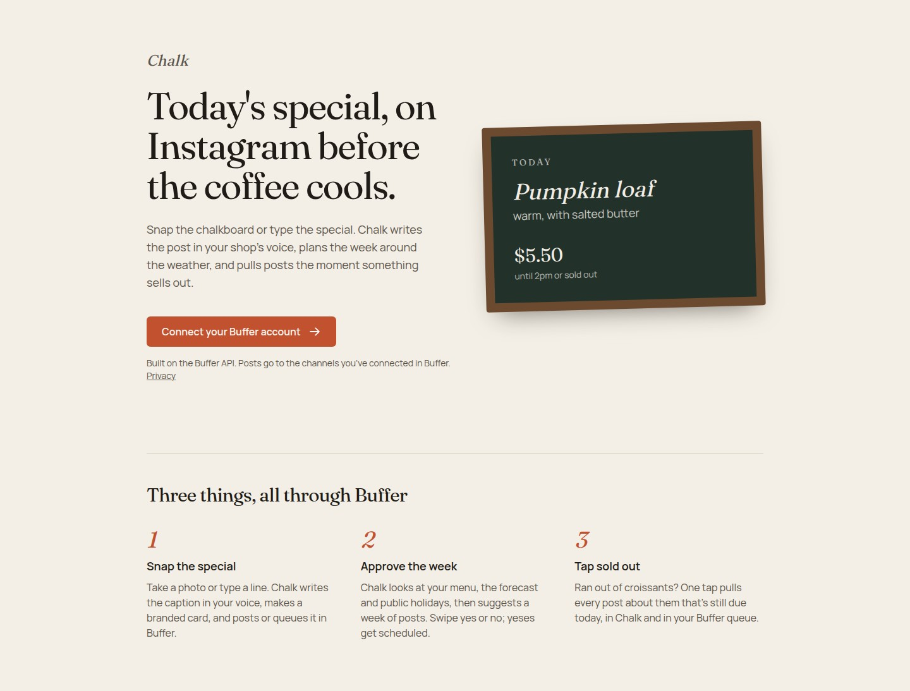
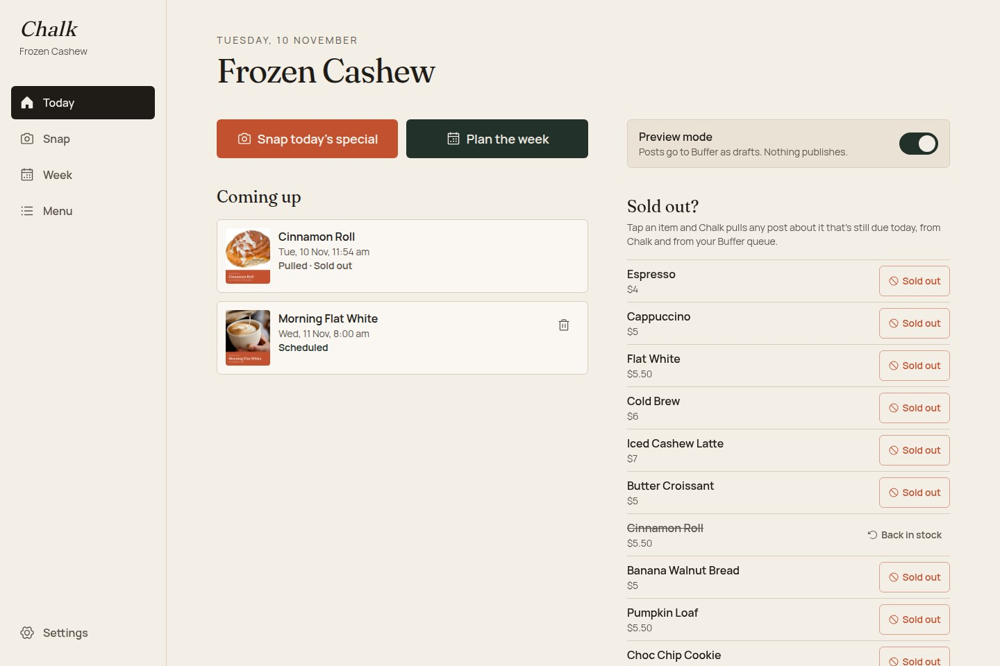
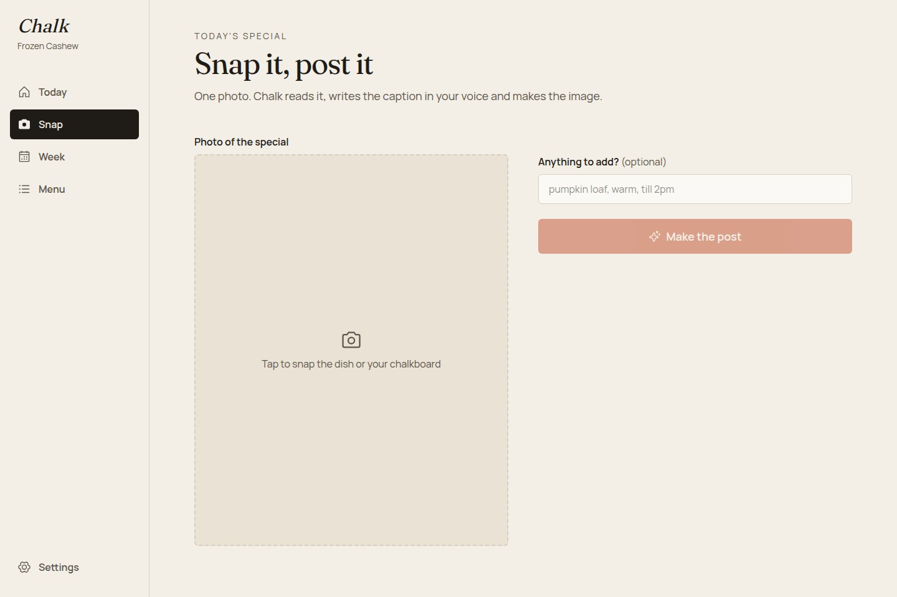
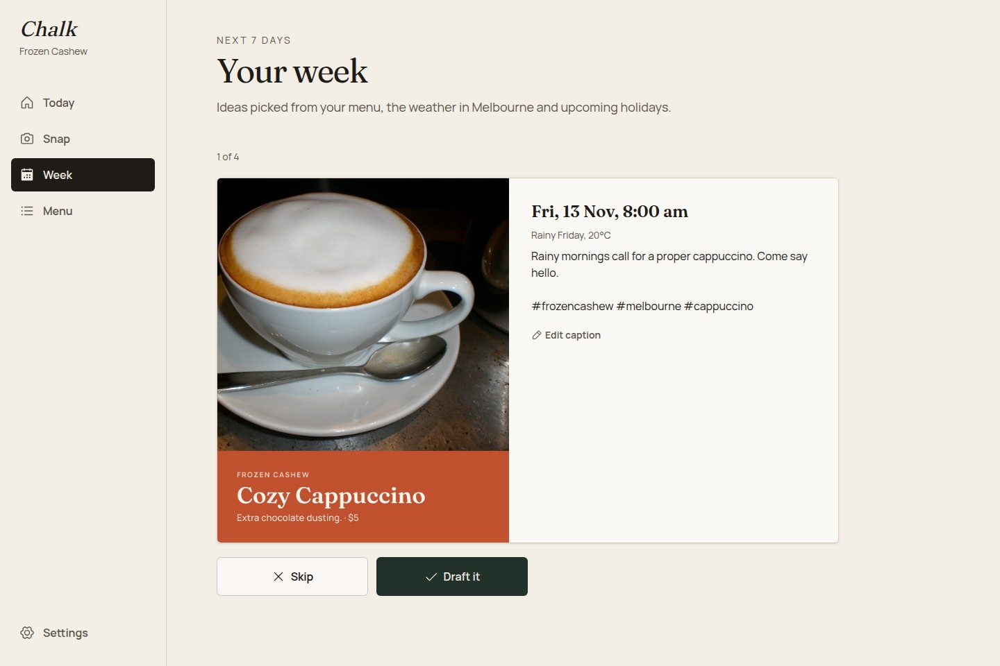
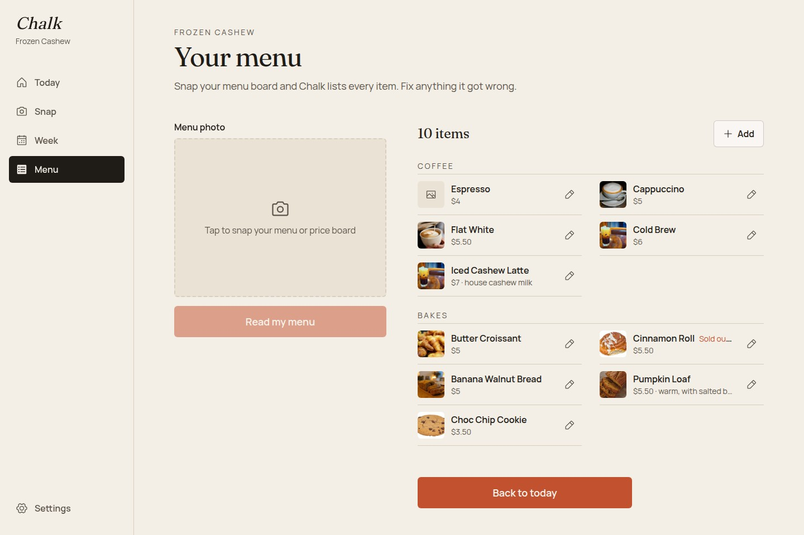

# Chalk

Social posts for small shops. Snap today's special, approve the week in one swipe, and Chalk publishes through [Buffer](https://buffer.com) to the channels you've connected there.

**Live app:** https://chalk-weld.vercel.app · **Demo video (2 min):** https://youtu.be/2ddMVrfZaY0

Built on the Buffer API. Not affiliated with or endorsed by Buffer.

[](https://youtu.be/2ddMVrfZaY0)

## What it does

A café owner doesn't want a social media manager. They want the pumpkin loaf on Instagram before the coffee cools. Chalk is built for that counter, not a marketing team.

| | |
| --- | --- |
| **Snap the special** — Take a photo or type a line. Gemini reads the photo, writes the caption in the shop's saved voice, and `next/og` renders a branded card. Send it now, queue it, schedule it, or save it as a Buffer draft. | **Approve the week** — Chalk reads the menu, the local forecast (Open-Meteo) and public holidays (Nager.Date), then suggests a week of posts. Swipe yes or no; yeses get scheduled in Buffer. |
| **Tap sold out** — Ran out of croissants? One tap finds every post about them still due today, in Chalk's own records and in the Buffer queue, and pulls them with `deletePost`. | **Set up in two steps** — Point the camera at the menu board and Chalk imports the items. Set the shop name, city, hours and voice once. |

## Screenshots



| Today | Snap a special |
| --- | --- |
|  |  |

| Plan the week | Menu |
| --- | --- |
|  |  |

## How it uses the Buffer API

Everything that touches a social network goes through Buffer's single GraphQL endpoint (`POST https://api.buffer.com`). The app client is private (confidential), so calls happen on the server.

| Buffer surface | Where Chalk uses it |
| --- | --- |
| OAuth 2.0 + PKCE | `auth.buffer.com` with scopes `account:read`, `posts:read`, `posts:write`, `offline_access` |
| `account` query | Buffer account and organization id, cached in the session at login |
| `channels` query | Channels cached on the shop and refreshed from settings |
| `createPost` | Publish, queue, `customScheduled`, or `saveToDraft` for preview mode |
| `posts` query | Find today's still-scheduled posts so sold-out can pull them too |
| `deletePost` | Remove a post when an item sells out (a post that's already gone counts as success) |

Notes from building against it:

- Mutation errors come back with HTTP 200 as a `__typename` union (`LimitReachedError`, `InvalidInputError`, and so on), so they're read from the payload, not the transport.
- `editPost` requires the full `text` + `assets` + `metadata.instagram` resent; changing the time also needs `mode: customScheduled`.
- There is no media upload endpoint, so images are hosted on Cloudinary and passed as a public URL.
- The rate limit is shared by every user of the app client, so calls are deduped per request, and a `429` is shown to the user instead of being retried in a loop.

## Stack

- Next.js 16 (App Router, Cache Components), React 19, TypeScript, Tailwind CSS 4
- Buffer GraphQL API with OAuth 2.0 + PKCE (private client)
- Session in an encrypted, HttpOnly cookie (JWE via `jose`)
- Neon Postgres + Drizzle ORM, Cloudinary for image hosting, `next/og` for post cards
- Gemini (`gemini-3.5-flash-lite`) for captions and menu reading
- Vitest for unit tests

## Local setup

1. Create a **private** app client at [publish.buffer.com/settings/api](https://publish.buffer.com/settings/api) → App Clients.
   - Scopes: `account:read`, `posts:read`, `posts:write`, `offline_access`
   - Redirect URI: `https://localhost:3000/api/auth/buffer/callback`
2. Copy env and fill it in:

   ```bash
   cp .env.example .env.local
   openssl rand -base64 48   # paste as SESSION_SECRET
   ```

3. Run:

   ```bash
   pnpm install
   pnpm certs      # one-time: self-signed cert in ./certificates (gitignored)
   pnpm dev        # https://localhost:3000
   ```

Buffer requires HTTPS redirect URIs even on localhost, so `pnpm dev` runs with `--experimental-https`. Accept the browser warning for the local certificate.

## Scripts

| Command | What it does |
| --- | --- |
| `pnpm dev` | Dev server over HTTPS |
| `pnpm build` | Production build |
| `pnpm test` | Unit tests |
| `pnpm lint` | ESLint |
| `pnpm typecheck` | TypeScript check |
| `pnpm db:generate` | Generate a Drizzle migration |
| `pnpm db:migrate` | Apply migrations |

## How auth works

```
/api/auth/buffer/login     create state + PKCE pair, store in sealed cookie, redirect to Buffer
/api/auth/buffer/callback  verify state, exchange code + verifier for tokens, store sealed session
src/proxy.ts               refresh the access token when expired, before pages render
/api/auth/logout           clear the session
```

- Tokens never reach browser JavaScript. They live only in an encrypted HttpOnly cookie.
- Refresh tokens are single-use and rotate. A failed refresh clears the session instead of retrying, because reusing a spent token revokes the whole grant.
- Buffer's rate limit is shared by every user of the app client, so API calls are deduped per request and 429s are shown to the user rather than retried in a loop.

## Deploy (Vercel)

Set `BUFFER_CLIENT_ID`, `BUFFER_CLIENT_SECRET`, `APP_URL` (your production URL) and a fresh `SESSION_SECRET` in the project settings, then add `<APP_URL>/api/auth/buffer/callback` as a second redirect URI on the same Buffer app client.

## Demo photo credits

The demo café uses photos from Wikimedia Commons. The menu and chalkboard images were made for this project.

| Item | Photo | Author | License |
| --- | --- | --- | --- |
| Croissants | [Croissants au beurre](https://commons.wikimedia.org/wiki/File:Croissants_au_beurre_(18953292873).jpg) | Herry Wibisono | CC0 |
| Cinnamon roll | [Cinnamon-Roll-US-Bakery](https://commons.wikimedia.org/wiki/File:Cinnamon-Roll-US-Bakery.jpg) | Evan-Amos | Public domain |
| Choc chip cookie | [Choc-Chip-Cookie](https://commons.wikimedia.org/wiki/File:Choc-Chip-Cookie.jpg) | Evan-Amos | Public domain |
| Banana walnut bread | [Banana bread cut into slices](https://commons.wikimedia.org/wiki/File:Banana_bread_cut_into_slices.jpg) | Shisma | [CC BY 4.0](https://creativecommons.org/licenses/by/4.0/) |
| Iced cashew latte | [Iced Coffee in Glass](https://commons.wikimedia.org/wiki/File:Iced_Coffee_in_Glass_-_Sunshine_Coffee_-_Laramie_Cafe_(53838344552).jpg) | Tony Webster | [CC BY 2.0](https://creativecommons.org/licenses/by/2.0/) |
| Pumpkin loaf | [Pumpkin Walnut Bread](https://commons.wikimedia.org/wiki/File:Pumpkin_Walnut_Bread.jpg) | Cphackm | [CC BY-SA 4.0](https://creativecommons.org/licenses/by-sa/4.0/) |
| Cappuccino | Wikimedia Commons | Jazzbobrown | Public domain |
| Flat white | Wikimedia Commons | Kim Sanso | CC0 |

Chalk crops these photos and adds text to make post cards.
